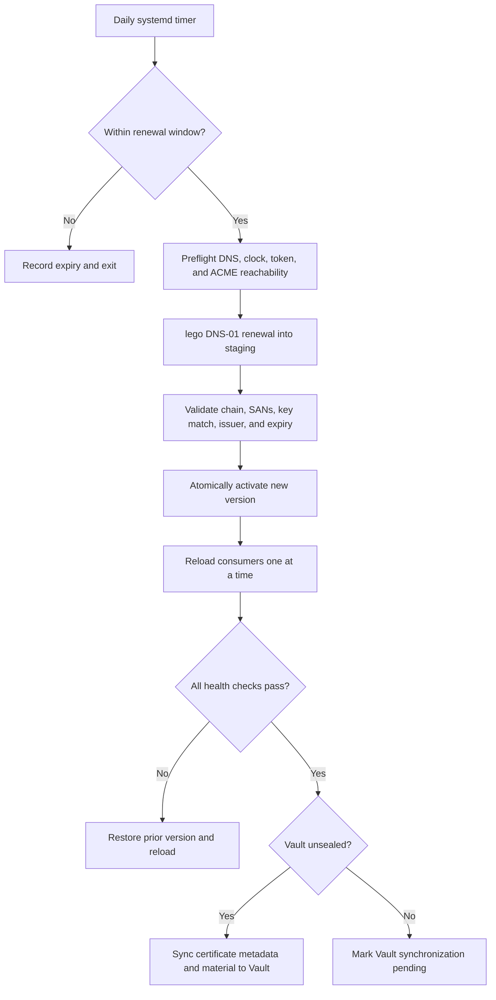

# Certificate Renewal and Deployment

> Status: Accepted target state — 2026-07-28

## Decision

The bootstrap host renews the wildcard certificate automatically. Renewal is a
host lifecycle responsibility and does not depend on GitLab, Runner, or an
unsealed Vault.

A systemd timer runs a daily eligibility check. When the certificate is within
30 days of expiry, a oneshot service uses lego and Cloudflare DNS-01 to obtain a
replacement, validates it in a staging directory, deploys it atomically, and
reloads each consumer with a health check. The previous certificate remains
available for immediate rollback.

Automatic renewal is enabled by default. The check schedule, renewal window, and
randomized delay are configurable, and automation can be disabled. A disabled
timer produces a persistent expiry warning rather than silently returning a
healthy status.

## Credential model

The recommended credential is a Cloudflare API token scoped to the one managed
DNS zone with only:

- Zone / Zone / Read; and
- Zone / DNS / Edit.

An operator who wants tighter separation may supply distinct Zone Read and DNS
Edit tokens. Global API keys are not the supported default.

The administrator retains the recovery copy in a password manager. The target
host keeps the minimum runtime copy in a root-owned mode `0600` file under the
bootstrap secret directory so renewal can succeed while Vault is sealed. The
service reads the value through lego's `_FILE` credential support. Token bytes
never appear in process arguments, structural configuration, Git, logs, TUI
output, or systemd unit text.

This is the same deliberate availability tradeoff as other protected runtime
secrets in ADR-009. Compromise of the bootstrap host could expose the scoped
token, but its permissions do not grant account-wide administration and its
resource scope is limited to the certificate zone.

## Renewal sequence



The service uses a lock so a manual renewal, timer run, and bootstrap rerun
cannot overlap. A successful eligibility check that does not renew is not
reported as a certificate change.

## Validation and atomic deployment

Before activation, the candidate must pass all of these checks:

1. PEM certificate and chain parse successfully.
2. The private key corresponds to the leaf certificate.
3. SANs contain `*.home.<domain>` and `home.<domain>` exactly as configured.
4. The issuer is the configured ACME CA.
5. The replacement expires later than the active certificate and is outside the
   configured renewal window.
6. File ownership and permissions match the consumer contract.

Each immutable version is stored below `/opt/certs/home.<domain>/versions/`.
The `current` symlink is switched with an atomic rename only after validation.
Consumers reference stable paths below `current`; incomplete staging files are
never visible to them.

Consumers are reloaded in a deterministic order and health-checked before the
next reload. If any reload or health check fails, the service restores the prior
symlink, reloads already-touched consumers, and reports the failed consumer.
The invalid candidate remains quarantined for diagnostics without containing
the Cloudflare token.

## Vault behavior

Vault is authoritative for certificate inventory and controlled distribution,
but it is not in the renewal critical path.

- When Vault is unsealed, a successful deployment updates the Vault certificate,
  private key, expiry, SAN, issuer, and version metadata.
- When Vault is sealed or unavailable, local deployment continues and platform
  status reports `certificate current; Vault sync pending`.
- Post-unseal reconciliation compares certificate fingerprints and completes the
  pending Vault update before clearing degraded status.
- Vault synchronization failure never rolls a healthy local certificate back.

## Operator interaction

Supported commands:

```text
bootstrap certificate status
bootstrap certificate renew
bootstrap vault reconcile
```

`status` reports the active fingerprint, expiry, remaining lifetime, next timer
run, last successful renewal, consumer health, and Vault synchronization state.
It never displays private key or token material.

Manual `renew` follows the same lock, staging, validation, activation, health,
and rollback path as the timer. A force option requires explicit confirmation
because unnecessary ACME issuance can consume rate limits.

## Failure behavior

| Failure | Required result |
|---|---|
| Cloudflare or ACME temporarily unreachable | Keep active certificate; retry on the next timer run; warn with remaining lifetime |
| Token rejected or insufficiently scoped | Keep active certificate; show corrective permission guidance without token bytes |
| DNS propagation timeout | Clean up the challenge when possible; keep active certificate; retry later |
| Candidate validation fails | Never activate it; quarantine diagnostics; keep active certificate |
| Consumer reload or health check fails | Roll back atomically and verify the restored consumer set |
| Vault sealed or unavailable | Keep new local certificate; mark synchronization pending |
| Certificate enters a critical expiry threshold | Escalate status and notifications on every run until resolved |
| Automation disabled | Show expiry and persistent manual-renewal warning |

## Required evidence

- Timer eligibility tests cover outside, inside, and beyond the renewal window.
- Pebble and the Cloudflare mock prove issuance without contacting production.
- Token bytes do not appear in arguments, environment dumps, logs, unit files,
  manifests, crash output, or TUI output.
- A mismatched key, wrong SAN, invalid chain, or non-advancing expiry cannot be
  activated.
- Failure of every individual consumer health check proves rollback.
- Renewal while Vault is sealed deploys locally and reconciles after unseal.
- Concurrent timer, manual, and bootstrap runs prove locking and idempotency.
- Expiry monitoring remains visible when automated renewal is disabled.

## Upstream references

- [lego certificate renewal](https://go-acme.github.io/lego/usage/cli/renew-a-certificate/index.html)
- [lego Cloudflare provider and token scoping](https://go-acme.github.io/lego/dns/cloudflare/)
