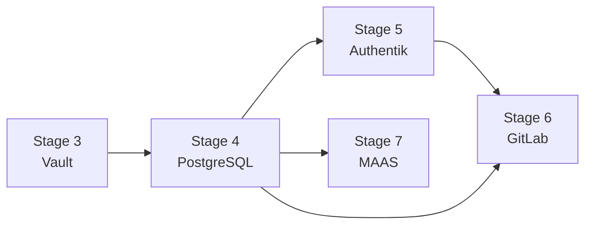

# PostgreSQL and Authentik Bootstrap Architecture

> Status: Accepted target state — 2026-07-26

## Decision

PostgreSQL is Stage 4. Authentik is Stage 5 and connects to its final PostgreSQL
database on its first start.

The dependency order is:

Stage 4 creates dedicated databases and roles for Authentik, GitLab, and MAAS.
Their generated credentials are recorded in Vault. Stage 5 reads only the
Authentik credential and renders the Authentik runtime configuration against the
shared PostgreSQL service.

The bootstrap compose definition must not create a temporary or bundled
Authentik PostgreSQL container. There is no bootstrap database migration,
`pg_dump`, `pg_restore`, DSN flip, or old Authentik database volume to clean up.

## Why

PostgreSQL does not depend on Authentik. Vault is already available to hold the
database credentials before PostgreSQL is installed. Creating the final database
first removes a circular dependency that existed only in the previous stage
ordering.

This reduces:

- irreversible data-moving operations during first installation;
- temporary credentials, storage, and compose branches;
- downtime and rollback logic;
- disk-space requirements for duplicate databases and dumps; and
- idempotency paths that distinguish pre- and post-migration Authentik.

The tradeoff is that the shared PostgreSQL service becomes a direct prerequisite
for Authentik. That dependency already exists in the intended steady state and
is therefore preferable to hiding it behind a temporary database.

## Stage 4 contract: PostgreSQL

Stage 4:

1. verifies Vault is unsealed;
2. installs and starts the pinned PostgreSQL version;
3. creates a unique role and database for `authentik`, `gitlab`, and `maas`;
4. writes each generated credential to its defined Vault path;
5. restricts network access to the configured service hosts/networks;
6. verifies each role can connect only to its intended database; and
7. records version, database, role, and health evidence without logging secrets.

Re-running the stage reconciles existing roles and databases without dropping,
recreating, or emptying them. A mismatch requires an explicit repair decision;
bootstrap must not replace an occupied database silently.

## Stage 5 contract: Authentik

Stage 5:

1. verifies Vault and PostgreSQL health;
2. verifies the Authentik database is reachable with its dedicated role;
3. renders the server and worker configuration using the final PostgreSQL DSN;
4. starts Authentik for the first time;
5. waits for Authentik's own schema migrations and health checks;
6. creates the bootstrap admin and durable API bootstrap credential;
7. has Terraform create groups, providers, applications, and policy bindings; and
8. verifies OIDC integration with Vault.

If first startup fails, the runtime configuration is retained for diagnosis and
the same stage is retried. The database is not dropped or restored automatically.
If Authentik has already initialized the expected database, a re-run verifies
and continues idempotently.

## Existing or brownfield Authentik installations

Importing an existing Authentik database is outside the clean-bootstrap path. A
future brownfield workflow must require a logical backup, static-file backup,
version compatibility check, explicit destination selection, restore validation,
and operator approval. It must never be inferred merely because an Authentik
database or container exists.

## Known implementation changes

The accepted target state intentionally differs from the current implementation.
Implementation work must:

- reorder and rename the Stage 4/5 Go runners and Ansible playbooks;
- run `postgresql_install` before `authentik_install` in `site.yml`;
- remove `authentik_use_bundled_postgres` and the conditional PostgreSQL service
  from the Authentik templates;
- remove `postgresql_install/tasks/migrate_authentik.yml` and its callers;
- require the final Authentik DSN when rendering its environment; and
- replace migration tests with direct-first-start, interruption, isolation, and
  backup/restore tests.

## Backup boundary

The Authentik backup set includes:

- the `authentik` PostgreSQL database;
- Authentik persistent uploaded/static data used by the deployment;
- custom templates or blueprints, when configured; and
- the runtime configuration needed to reconnect to the database, with secrets
  recovered through Vault and the approved protected runtime-copy model.

Shared PostgreSQL does not mean one shared database identity. Each service keeps
its own database, role, credential, backup verification, and restore target.

## Required evidence

Implementation is not complete until tests demonstrate:

- Stage 4 fresh install and no-change re-run;
- distinct roles cannot connect to another service's database;
- Stage 5 starts Authentik directly against the Stage 4 database;
- no bundled PostgreSQL container or migration command is invoked;
- interrupted Authentik initialization can be retried safely;
- seeded Authentik users, groups, flows, and OIDC configuration survive a
  PostgreSQL backup/restore drill; and
- PostgreSQL and Authentik restart successfully after a host reboot.
