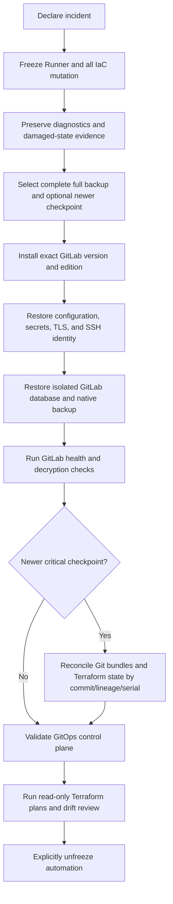

# GitLab Loss and GitOps Recovery

> Status: Accepted target state — 2026-07-28

## Decision

GitLab recovery uses two complementary protection layers:

1. a nightly, application-consistent full GitLab backup for the instance,
   repositories, metadata, artifacts, and Terraform state; and
2. an encrypted critical checkpoint after every successful infrastructure
   apply, containing Git bundles for the critical GitOps repositories and
   decrypted Terraform state exports.

The nightly layer targets a recovery point of less than 24 hours for ordinary
GitLab content. The post-apply layer targets the exact successful apply for the
critical code and state needed to reconstruct infrastructure intent.

When GitLab is unavailable or its integrity is uncertain, all Terraform and
GitOps mutation freezes. A host-side recovery command restores and validates
GitLab without depending on GitLab CI. Automation resumes only after an
explicit unfreeze.

## Why both layers are required

GitLab's native backup includes repositories, database content, artifacts, and
Terraform state, but it does not include the complete `/etc/gitlab`
configuration, secrets, TLS keys, SSH host keys, or other system files.

GitLab-managed Terraform state is encrypted with instance key material. The
encrypted files and GitLab database are both required for normal recovery, and
the instance must be available to decrypt state through its API. A separate
decrypted export closes the circular dependency without making local Terraform
the routine control plane.

## Recovery objectives

| Data class | Target recovery point | Recovery priority |
|---|---:|---:|
| Critical GitOps repositories | Last successful apply | Highest |
| Terraform state and lineage metadata | Last successful apply | Highest |
| GitLab configuration, secrets, identity, and exact package | Nightly and after every upgrade | Highest |
| Other repositories and GitLab database content | Less than 24 hours | Normal |
| CI artifacts, job logs, uploads, packages, and registry | Less than 24 hours when enabled | Lower |
| Redis cache and Sidekiq transient work | Not recovered | Recreated |

The recovery-time objective is not a hard v1 SLA. Restore drills record actual
duration and use it to improve the operator estimate.

## Nightly full backup set

The ordinary 02:30 backup workflow creates a consistent GitLab set before
Restic runs:

- native GitLab application backup;
- the isolated GitLab PostgreSQL database dump and role metadata from the
  shared database backup;
- `/etc/gitlab/gitlab.rb`;
- `/etc/gitlab/gitlab-secrets.json`;
- GitLab TLS files, trusted certificates, and SSH host keys;
- Runner configuration and registration metadata;
- GitLab version, edition, architecture, OS release, package source, and
  package checksum;
- the exact installed GitLab package artifact when legally and technically
  redistributable within the operator's private backup;
- object-storage content if a future configuration moves supported data out of
  local storage; and
- a manifest tying every artifact to one backup run and GitLab version.

Configuration and secret archives remain separate components inside the
encrypted Restic repository rather than being embedded into the native GitLab
archive. This preserves the documented distinction between encrypted
application data and its decryption keys while keeping both recoverable.

## Post-apply critical checkpoint

After a Terraform apply succeeds and postconditions pass, the pipeline invokes a
target-host checkpoint service before reporting the change fully protected.
The checkpoint:

1. records project IDs, repository default branches, applied commit SHA,
   pipeline ID, Terraform workspace/state name, lineage, serial, and apply time;
2. creates full Git bundles for the bootstrap and infrastructure/GitOps
   repositories needed for recovery;
3. downloads the latest decrypted Terraform state for every state changed by
   the apply;
4. validates each bundle and parses each state export;
5. writes temporary plaintext only to a root-only tmpfs staging directory;
6. snapshots the set directly into the encrypted primary Restic repository with
   `gitlab-critical`, project, workspace, and apply tags;
7. reopens the snapshot and verifies its manifest, object hashes, commit
   presence, lineage, and serial; and
8. removes the tmpfs staging set.

The checkpoint is not successful merely because the apply succeeded. Platform
status distinguishes:

- `apply succeeded; recovery checkpoint verified`;
- `apply succeeded; checkpoint pending`;
- `apply succeeded; checkpoint failed`; and
- `trial mode; no repository checkpoint`.

A failed checkpoint does not roll infrastructure back. It pages when configured
and blocks later unattended data-bearing or major upgrades until recovery
protection is restored.

## Trial mode

Without a Restic repository, post-apply critical checkpoints cannot be
protected from host loss. GitLab and Terraform may continue in the supported
trial profile, but status remains visibly unprotected.

The operator may run the accepted one-time controller export. That export may
include the critical Git bundles and decrypted state set, encrypted on the
administrator laptop. A same-host copy never satisfies the GitLab loss
protection requirement.

## Incident classes

### Service failure with data intact

Use `bootstrap recover gitlab --mode service` to:

- verify pinned SSH identity and GitLab version;
- freeze Runner pickup and Terraform/GitOps mutation;
- run configuration, storage, PostgreSQL, Gitaly, Redis, and filesystem checks;
- repair or reapply the Ansible-owned runtime without restoring data;
- verify GitLab end to end; and
- ask for explicit unfreeze.

### GitLab data loss or corruption

Use `bootstrap recover gitlab --mode restore` to select and inspect a complete
backup set, install the exact GitLab version, restore configuration and secrets,
restore only GitLab's isolated database and application data, then reconcile any
newer verified critical checkpoint.

### Complete target loss

Controller reconstruction first establishes a replacement administrator
laptop, audits the target, and explicitly adopts it using
[controller-recovery.md](controller-recovery.md). Restoration of a replacement
Ubuntu target then follows the same version, secret, full-backup, and checkpoint
sequence. A replacement target uses the accepted SSH changed-key workflow and
never silently reuses the prior trust pin.

## Restore sequence

### Selection and preflight

The TUI shows:

- backup and checkpoint timestamps;
- GitLab version/edition and package hash;
- included/missing components;
- repository commits and Terraform state serials;
- last successful integrity check;
- estimated data-loss window; and
- available disk space.

An incomplete set, missing secrets, mismatched edition/version, unverified
package, invalid bundle, state-lineage mismatch, or insufficient space blocks
the restore before destructive work.

### Base restore

1. Place a persistent incident freeze marker read by all GitOps/Terraform jobs.
2. Stop Runner job pickup and wait or terminate only with operator approval.
3. Preserve logs and a protected snapshot of current damaged state when space
   permits.
4. Install the exact GitLab version and edition recorded in the manifest.
5. Restore `gitlab.rb`, `gitlab-secrets.json`, TLS/trusted-certificate files,
   and the intended SSH identity.
6. Reconfigure a working empty GitLab installation.
7. Restore only the GitLab database/role within shared PostgreSQL; never replace
   Authentik, MAAS, or other service databases.
8. Restore the native GitLab archive and any separately protected object data.
9. Run GitLab application, Gitaly, database, secrets-decryption, repository, and
   background-migration checks.

### Newer critical checkpoint reconciliation

When the critical checkpoint is newer than the full backup:

1. compare the full-backup and checkpoint commit graph;
2. import only fast-forward or otherwise explicitly validated Git bundle refs;
3. compare Terraform workspace identity, lineage, serial, and applied commit;
4. restore the newer state through GitLab's authenticated Terraform-state API;
5. download it again and compare its canonical hash and metadata;
6. run `terraform plan -refresh-only` and ordinary saved plans without apply;
7. require review of any drift, missing resource, or destructive proposal; and
8. retain the older state version and checkpoint until the recovery drill or
   incident is closed.

The tool never combines an unrelated Git commit and state serial merely because
both are newest.

## Verification gate

Automation cannot unfreeze until all required checks pass:

- administrator login and Authentik OIDC login;
- project/group visibility, issues, and merge requests;
- clone and push of a disposable branch;
- expected critical repository commit SHAs;
- Terraform state list, lineage, serial, and re-download;
- read-only plans that do not propose unexplained replacement or destruction;
- GitLab secrets decryption;
- Runner registration and a harmless test job;
- registry/package access when enabled;
- backup and critical-checkpoint capability; and
- Kuma/Beszel/health-adapter monitors.

The final screen shows evidence and requires explicit
`bootstrap recover gitlab --unfreeze <incident-id>` or an equivalent typed
confirmation. Merely making the web UI respond does not resume applies.

## Break-glass local Terraform

Local Terraform execution from a decrypted checkpoint is supported only when
GitLab cannot be restored in time and a necessary infrastructure repair is
required to recover GitLab itself.

The workflow:

- requires a named incident and typed break-glass confirmation;
- uses an isolated working directory and the exported state lineage;
- allows only a reviewed saved plan;
- rejects destructive changes by default;
- snapshots the state before and after the operation;
- records every command and resulting serial without secret values; and
- imports the reconciled state back into GitLab before normal automation
  resumes.

It is not automatic failover and does not make the controller laptop a second
routine Terraform backend.

## Failure behavior

| Failure | Required result |
|---|---|
| Full backup missing secrets/config | Block restore; select another set |
| Exact GitLab package unavailable | Use verified cached artifact; do not restore into a different version |
| Shared PostgreSQL restore targets other databases | Block before mutation |
| Native restore fails | Keep freeze; preserve logs and selected backup; allow bounded retry |
| Critical Git bundle diverges | Stop automatic reconciliation; require branch/ref review |
| Terraform lineage or serial conflicts | Keep restored base state; require state-selection review |
| Verification check fails | Keep automation frozen and identify the failing gate |
| Checkpoint failed after a successful apply | Preserve live state, report recovery gap, retry checkpoint |

## Required evidence

- Nightly backup contains every documented GitLab data, config, secret,
  identity, version, package, and manifest component.
- A checkpoint after a test apply restores the exact applied Git commit and
  Terraform state serial.
- Plaintext state exists only in protected tmpfs and is absent after success and
  injected failure.
- Restore rejects wrong GitLab version/edition, missing secrets, wrong package
  hash, incomplete database scope, invalid Git bundle, and state-lineage
  mismatch.
- Shared PostgreSQL fixtures prove only the GitLab database is replaced.
- Full-backup-only and full-backup-plus-newer-checkpoint restores pass.
- Every verification gate is failure-injected and keeps the incident frozen.
- Break-glass local Terraform produces before/after protected states and cannot
  resume normal automation without GitLab reconciliation.
- Quarterly restore drills record recovery time and achieved recovery point.

## Upstream references

- [Back up GitLab](https://docs.gitlab.com/administration/backup_restore/backup_gitlab/)
- [Restore GitLab](https://docs.gitlab.com/administration/backup_restore/restore_gitlab/)
- [GitLab configuration backup](https://docs.gitlab.com/omnibus/settings/backups/)
- [GitLab Terraform state administration](https://docs.gitlab.com/administration/terraform_state/)
- [GitLab-managed Terraform state disaster recovery](https://docs.gitlab.com/user/infrastructure/iac/terraform_state/#disaster-recovery-considerations)
