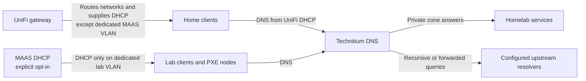

# DNS and DHCP Cutover

> Status: Accepted target state — 2026-07-26
> Router implementation guide: [UniFi network guide](unifi-network-guide.md)

## Decision

Bootstrap owns only the homelab-side preparation:

- Stage 1 installs and validates Technitium on a stable server IP.
- Bootstrap does not change the router, gateway, or DHCP settings for existing
  home networks.
- Technitium initially serves the bootstrap server and homelab clients.
- Stage 7 installs and configures MAAS, but MAAS DHCP is disabled by default.
- Enabling MAAS DHCP is a separate, explicit cutover for one dedicated lab VLAN.
- After bootstrap is stable, the operator may use the UniFi guide to advertise
  Technitium as the DNS resolver to each home network, one network at a time.

The intended final state is that clients on all selected home networks send DNS
queries to Technitium. The default bootstrap remains lab-only because changing
whole-home DNS during service installation creates an unnecessary outage domain.

## Target topology

UniFi remains the router and the DHCP authority for ordinary home networks.
MAAS may become the DHCP authority only for the dedicated provisioning VLAN.
There must never be two active DHCP authorities on that VLAN.

## Required network inputs

The wizard and structural configuration must collect:

| Field | Purpose |
|---|---|
| `bootstrap_server_ip` | Stable address used by Technitium and service records |
| `lab_vlan_id` | Dedicated lab/provisioning VLAN tag |
| `lab_vlan_interface` | Target interface that can receive the lab VLAN |
| `lab_vlan_subnet` | Lab network CIDR |
| `lab_gateway` | UniFi gateway address on the lab network |
| `dhcp_range_low` / `dhcp_range_high` | MAAS dynamic range, contained by the lab subnet |
| `maas_dhcp_enabled` | Explicit opt-in; defaults to `false` |

The stable Technitium address must be outside every dynamic pool or protected by
an equivalent reservation. The wizard rejects a gateway, server address, or
DHCP range that is outside the subnet or overlaps another configured role.

## Phase 1: Technitium for the homelab

Before making changes, Stage 1:

1. Confirms the server address is assigned to the expected interface.
2. Checks TCP and UDP port 53 and TCP port 5380 for conflicts.
3. Captures the current resolver configuration and upstream DNS addresses in the
   run manifest, without recording secrets.
4. Confirms that the selected upstream resolvers are reachable.

Stage 1 then installs Technitium, waits for API and DNS health, and has Terraform
create the private zone and bootstrap records. Only after direct queries to
Technitium resolve both a private service name and an external name may the
target server start using the local resolver.

Changing the target resolver is atomic. If the post-change query fails, bootstrap
restores the captured resolver configuration and leaves existing home networks
untouched. A Stage 1 retry must distinguish a healthy existing Technitium
instance from an unrelated process occupying a required port.

## Phase 2: Optional MAAS DHCP cutover

`maas_dhcp_enabled` defaults to `false`. With that default, Stage 7 installs MAAS,
creates its durable network objects, imports images, and verifies the API without
changing DHCP authority.

When the operator explicitly opts in, the TUI displays a cutover plan containing:

- interface, VLAN, subnet, gateway, and dynamic range;
- the currently observed DHCP authority;
- the proposed MAAS rack controller and DNS server;
- the manual UniFi step and rollback instructions.

The operator must disable UniFi DHCP on only the dedicated lab VLAN and confirm
that action in the TUI. Bootstrap then repeats its conflict probe. It enables
MAAS DHCP only when:

1. the VLAN is present on the configured interface;
2. the subnet, gateway, server address, and range validate;
3. no other DHCP offer is observed during the bounded probe;
4. the MAAS rack controller is healthy on that VLAN; and
5. Technitium answers private and external queries from the VLAN.

If MAAS activation or its verification fails, bootstrap disables any partially
enabled MAAS DHCP configuration and tells the operator to re-enable UniFi DHCP
on that lab network. Because v1 has no UniFi API integration, restoring UniFi
DHCP remains an explicit operator action.

## Phase 3: Whole-home DNS through UniFi

Whole-home DNS is a post-bootstrap operation, not a bootstrap success condition.
The operator follows [the UniFi guide](unifi-network-guide.md) and changes one
network at a time. Each network must pass these checks before continuing:

1. a renewed client lease advertises only the intended internal resolver set;
2. private homelab names resolve to private addresses;
3. ordinary internet names resolve;
4. DNS works after a Technitium restart; and
5. restoring the prior UniFi DNS setting returns the client to its former state.

Do not advertise a public resolver as a client-side “secondary” alongside a
single Technitium instance. Clients do not consistently treat the first address
as primary; they may bypass Technitium, causing intermittent private-name
failures and DNS-policy leakage. The v1 single Technitium server is therefore an
accepted DNS availability risk. The resilience upgrade is a second internal
resolver with the same private zones, after which UniFi can advertise both
internal addresses.

## Ownership and GitOps handoff

- Ansible owns the Technitium and MAAS software, host networking files, services,
  and health checks.
- Terraform owns Technitium zones/records and MAAS fabrics, VLANs, subnets, and
  ranges from their first creation.
- Go owns validation, the saved plan, approval, sequencing, and rollback evidence.
- UniFi settings are operator-owned in v1 and are documented rather than changed
  by the bootstrap tool.

After the GitLab handoff, zone, record, and MAAS network-object changes flow
through GitOps. UniFi network DNS and DHCP changes continue to follow the
operator guide until a separately reviewed UniFi provider/API integration is
introduced.

## Required evidence

Implementation is not complete until tests demonstrate:

- port-conflict detection for TCP and UDP DNS;
- target resolver rollback after a forced Technitium failure;
- no DHCP changes when `maas_dhcp_enabled: false`;
- refusal to enable MAAS when another DHCP offer is observed;
- successful PXE lease and DNS resolution after an approved lab cutover;
- a second run that produces no unintended network changes; and
- a documented UniFi network-by-network rollout and rollback drill.
