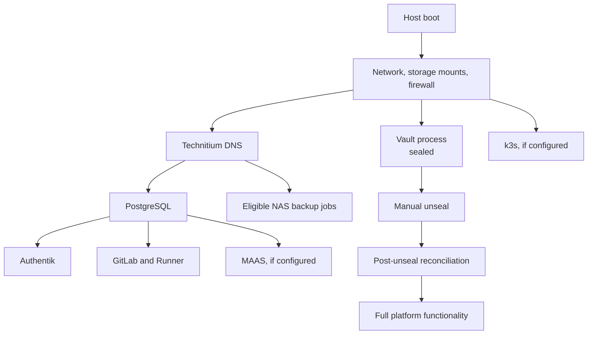

# Reboot and Manual-Unseal Recovery

> Status: Accepted; ARM64 disposable reboot/unseal/reconcile drill passed — 2026-08-26

## Decision

An ordinary host reboot restores household DNS and the main platform without
waiting for Vault to be manually unsealed. Vault still starts sealed and retains
the accepted Shamir manual-unseal model.

Core services start from their minimum protected local runtime credentials:

- Technitium;
- PostgreSQL;
- Authentik;
- GitLab and Runner;
- MAAS, when installed;
- the k3s control plane and workloads that do not need a fresh Vault operation;
  and
- primary NAS backups for components that do not require the Vault API.

Vault remains authoritative for these credentials. The local copies are
root-owned, mode `0600`, version-controlled by neither Git nor logs, and
reconciled after Vault is unsealed.

## Startup sequence



Systemd dependency and readiness checks enforce the sequence. A service is not
considered ready merely because its process is running.

## Behavior while Vault is sealed

Available:

- home and homelab DNS;
- PostgreSQL-backed Authentik and GitLab login;
- GitLab repositories and non-Vault-dependent jobs;
- ordinary service traffic using valid protected runtime credentials;
- automatic certificate renewal and local certificate deployment;
- MAAS and k3s operations that do not require a new secret; and
- partial backup runs for components whose native artifact does not require Vault.

Paused or incomplete:

- Vault reads, writes, login, rotation, and policy changes;
- GitLab jobs that authenticate to Vault;
- Terraform plans/applies that initialize the Vault provider;
- new Vault Agent or Kubernetes Injector secret delivery;
- reconciliation of changed authoritative secrets into runtime files; and
- creation of a fresh Vault Raft snapshot.

The platform status must say **degraded: Vault sealed**, not healthy. A backup
completed during this period is marked incomplete if it could not create a fresh
Vault snapshot.

## Manual unseal interaction

The supported operator flow is:

```text
bootstrap vault status
bootstrap vault unseal
```

The TUI:

1. verifies the pinned SSH host identity;
2. confirms the expected Vault cluster identity and seal status;
3. prompts for one Shamir share at a time with masked input;
4. submits each share through the Vault API without placing it in arguments,
   shell history, logs, or persistent files;
5. displays progress as `N of threshold` without displaying key material; and
6. stops if the cluster identity changes or Vault resets unseal progress.

The operator normally retrieves shares from the password manager. The default
workflow does not automatically ingest `vault-init.json` or retain entered
shares. `--from-init-file` is an explicit recovery/disposable-automation option;
it is never selected implicitly and the shares still travel only on SSH stdin.

[Vault starts sealed](https://developer.hashicorp.com/vault/docs/concepts/seal)
and before unseal it permits status and unseal operations rather than normal
data access. This repository therefore treats manual unseal as an expected
degraded state rather than a failed host boot.

## Post-unseal reconciliation

Successful unseal triggers a bounded reconciliation job:

1. verify Vault health, cluster identity, Raft peer state, and audit device;
2. verify Authentik OIDC discovery and Vault login configuration;
3. test GitLab JWT authentication to Vault without exposing a token;
4. compare authoritative secret versions with protected runtime-copy metadata;
5. atomically refresh only stale runtime files and reload affected services;
6. create the missed Vault Raft snapshot when the backup policy is enabled;
7. synchronize any certificate renewed while Vault was sealed;
8. run deferred Vault-dependent health checks; and
9. change platform status from degraded to healthy only after all required
   checks pass.

A mismatch is displayed as a proposed reconciliation. It never overwrites a
runtime credential and restarts a service silently when doing so could cause an
outage.

## Failure and retry

- Wrong share: show the Vault error, preserve valid progress, and re-prompt.
- Unseal progress reset: stop and explain that the threshold sequence must restart.
- Vault fails after reaching threshold: collect service and Raft diagnostics;
  do not restart dependent services unnecessarily.
- Reconciliation failure: leave already-running services on their prior runtime
  copies, identify the stale component, and allow targeted retry.
- Administrator unavailable: the platform remains in the documented degraded
  state; it does not attempt to discover or reconstruct shares.

## Required evidence

Evidence recorded 2026-08-26: an ARM64 QEMU host rebooted with its full platform
installed; a normal bootstrap rerun stopped safely at sealed Vault and printed
the recovery command; the configured threshold was submitted without argument
or log exposure; `vault reconcile` refreshed certificate inventory and the
periodic backup token; and the subsequent complete bootstrap rerun passed. The
same run proved DNS, PostgreSQL, Authentik, GitLab, MAAS, and k3s service startup.
The remaining matrix item is an x86_64 run and deliberate stale-runtime-copy
injection.

- Cold-boot test with Vault sealed proves DNS, PostgreSQL, Authentik, and GitLab
  health before unseal.
- Vault-dependent CI and secret operations fail closed while sealed.
- Unseal shares never appear in process arguments, terminal history, logs,
  manifests, crash reports, or temporary files.
- Post-unseal reconciliation detects both matching and stale runtime copies.
- Backup status distinguishes complete, partial, and last-valid Vault snapshot age.
- Reboot, unseal, reconciliation, and second-reboot drills pass on x86_64 and ARM64.
